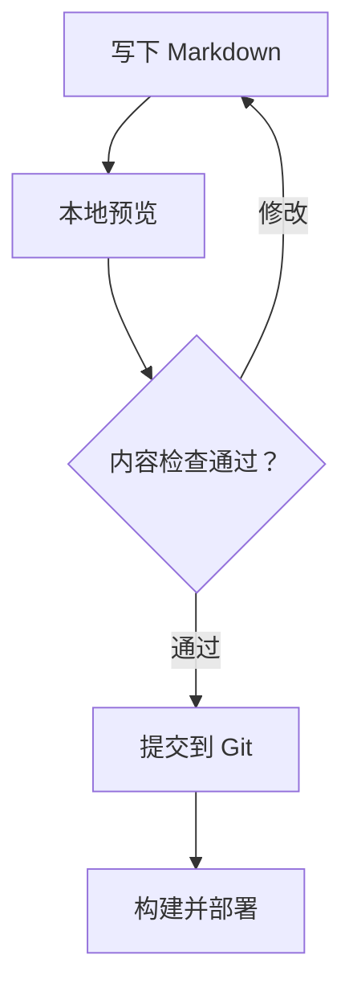

## 这是一篇排版示例

这篇文章用于展示技术博客的常见排版。可以下载本页的 Markdown 源文件，复制需要的写法，再删除这篇示例。

## 代码块

代码块后写上语言名称，就能自动高亮。代码区域也支持复制与全屏查看。

```java title="BinarySearch.java"
public static int binarySearch(int[] values, int target) {
    int left = 0;
    int right = values.length - 1;
    while (left <= right) {
        int mid = left + (right - left) / 2;
        if (values[mid] == target) return mid;
        if (values[mid] < target) left = mid + 1;
        else right = mid - 1;
    }
    return -1;
}
```

代码中的区间是闭区间 `[left, right]`，循环条件对应 `left <= right`。排序数组是使用这段算法的前提。

## 数学公式

行内公式使用一对美元符号：折半查找的时间复杂度是 $O(\log n)$。

独立公式使用两对美元符号：

$$
\sum_{k=1}^{n} k = \frac{n(n+1)}{2}
$$

## 对比表格

| 方法 | 前提 | 时间复杂度 |
| --- | --- | --- |
| 顺序查找 | 无需排序 | $O(n)$ |
| 折半查找 | 有序、支持随机访问 | $O(\log n)$ |

## 流程图



## 提醒与折叠内容

:::info
技术笔记最好记录版本、前提和验证方式。下次回看时，这些信息比单独的一段命令更有用。
:::

+++ 点击展开一段补充说明

可以把推导细节、长输出或补充代码放进折叠块，让主线更容易阅读。

+++

## 让文章容易找到

每篇文章设置一个简短描述、一个主要分类和几个准确标签。目录跟随标题层级生成，分类和标签页面在构建时自动更新。
