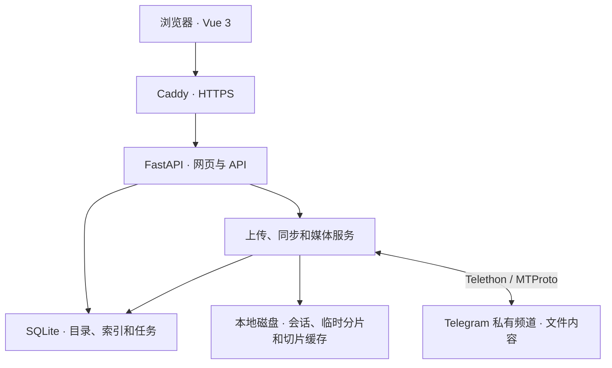

一个视频传到一半，关掉网页再回来，怎么知道该从哪个字节接着传？视频入库之后，进度条拖到中间，服务器又该到哪里取那一小段数据？这两个问题贯穿了 TG Drive 的开发，也决定了它的主体框架。

TG Drive 是一个自托管的个人网盘。它把文件内容存进 Telegram 私有频道，网页负责上传、整理、搜索、分享和播放。这是开发历程的第一篇，下面按仓库提交记录回顾框架怎么演进，再跟着一个视频走完上传和播放。本文以 2026 年 11 月 23 日的 `main` 提交 `e2c80f6` 为准。[项目仓库](https://github.com/KubaZzZo/tgdrive) · [源码快照](https://github.com/KubaZzZo/tgdrive/tree/e2c80f6f1d25c9c47e533b127405001e9cf91f2d)

## 从第一版到现在

| 时间 | 这一步做了什么 |
| --- | --- |
| 11 月 4 日，首个提交 | 用静态 HTML、CSS 和 JavaScript 做网页，支持文件夹、分享、断点续传和 HTTP Range 播放。第一版已经有 Docker Compose 和 Caddy 部署配置。[首个提交](https://github.com/KubaZzZo/tgdrive/commit/110508aa785630c08d45018b8d0c3f48dc897dce) |
| 11 月 4 日，第一轮重构 | 前端换成 Vue 3、TypeScript 和 Pinia。后端从集中在 `app/main.py` 的实现里拆出鉴权、文件和上传路由，上传后台逻辑移入服务层。[重构提交](https://github.com/KubaZzZo/tgdrive/commit/d40d13b8c08f2c13ae0b7f76c630c684d3275d69) |
| 11 月 12 日至 14 日，逐步补齐分层 | 加入服务端视频切片缓存，随后拆分 SQLite 仓储和 HTTP 请求模型，并用 Vue Router 管理页面与导航。[切片缓存](https://github.com/KubaZzZo/tgdrive/pull/16) · [数据库拆分](https://github.com/KubaZzZo/tgdrive/commit/5f3ea9df67c9047deaf9eec3780dee922a417e04) · [前端路由](https://github.com/KubaZzZo/tgdrive/commit/5e1d2bde0b8a5eb1a54c1ce1050fe1857b3bcda9) |

第一版先把上传、整理、分享和播放串成完整流程。后来加入频道历史同步和账号切换，数据库要记录消息游标和各频道的索引，上传和同步也有了各自的后台任务。现在读代码，可以从页面一路追到 API、业务服务和存储层。

## 主体框架与技术栈

| 层 | 技术栈 | 在项目里负责什么 |
| --- | --- | --- |
| 前端 | Vue 3、TypeScript、Pinia、Vue Router、Vite | Pinia 管理认证、文件列表与上传队列。Vue Router 负责页面切换，目录、搜索等筛选条件放在 URL 查询参数中，刷新后可以恢复。 |
| API 与业务 | Python 3.12、FastAPI、Uvicorn | 路由接收请求并组装响应，服务层处理上传、同步和媒体缓存。`create_app()` 组装这些依赖，测试时可以注入临时数据库和模拟存储。 |
| 数据与文件 | SQLite、Telethon、Telegram 私有频道 | SQLite 保存目录、任务偏移、分享及文件与频道消息的映射。Telethon 负责读写 Telegram，文件内容落在频道里。 |
| 媒体与部署 | HTTP Range、FFmpeg、Docker Compose、Caddy | Range 支持按字节读取，FFmpeg 用于抽帧和部分 MP4 的索引前置。镜像先构建前端，再把静态产物打包进 Python 镜像，由 FastAPI 同源提供页面和 API，Caddy 负责 HTTPS 入口。 |

后端入口是 `app/main.py`，往下可以沿 `app/api/routes/`、`app/services/`、`app/infrastructure/` 读到请求、业务和存储。SQLite 跟踪 `PRAGMA user_version`，打开数据库时按版本执行迁移。部署以单应用实例、单 Uvicorn worker 为基础，上传任务锁和频道切换都依赖这个边界。[架构文档](https://github.com/KubaZzZo/tgdrive/blob/e2c80f6f1d25c9c47e533b127405001e9cf91f2d/docs/ARCHITECTURE.md) · [前端依赖](https://github.com/KubaZzZo/tgdrive/blob/e2c80f6f1d25c9c47e533b127405001e9cf91f2d/frontend/package.json) · [Dockerfile](https://github.com/KubaZzZo/tgdrive/blob/e2c80f6f1d25c9c47e533b127405001e9cf91f2d/Dockerfile)

## 跟着一个视频走一遍

### 上传有两段进度

浏览器把文件切片发给 FastAPI，服务端将分片写入临时目录，持久化已确认的偏移。网络中断后，重新选择同一个文件，前端可以按内容匹配原任务，从服务器确认的位置继续。分片全部到齐后，后台任务再用 Telethon 将文件写入频道，把消息映射登记到 SQLite。

所以页面上的「已传到服务器」和「已存入网盘」是两个状态。后一段还会遇到 Telegram 超时或限流，需要自己的进度和重试状态。前端通过 SSE 接收任务快照，连接断开后可以再查询状态。[上传状态机](https://github.com/KubaZzZo/tgdrive/blob/e2c80f6f1d25c9c47e533b127405001e9cf91f2d/docs/ARCHITECTURE.md#上传状态机)

### 播放从所需的字节读起

拖动播放进度条时，浏览器会通过 `Range` 请求一段字节。FastAPI 根据 SQLite 里的分段映射定位到对应的频道消息，从磁盘缓存或 Telegram 取出所需范围，并返回带 `Content-Range` 的 `206 Partial Content` 响应。浏览器可以边接收边播放，服务器也可以用切片缓存减少重复回源。[媒体路由源码](https://github.com/KubaZzZo/tgdrive/blob/e2c80f6f1d25c9c47e533b127405001e9cf91f2d/app/api/routes/files.py) · [视频播放说明](https://github.com/KubaZzZo/tgdrive/blob/e2c80f6f1d25c9c47e533b127405001e9cf91f2d/docs/video-playback.md)

文件正文放在 Telegram，服务器仍要承担上传时的临时磁盘空间，以及播放时从 Telegram 取回并转发给客户端的流量。理解这三个位置各存什么、数据经过哪里，后面看续传、缓存和频道同步时就有了同一张地图。
